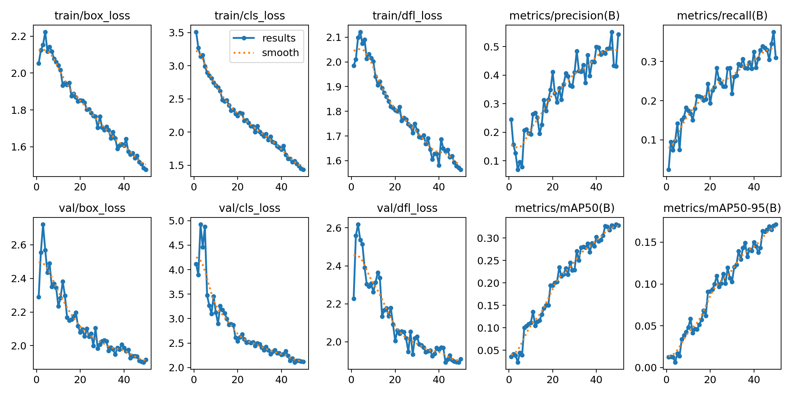
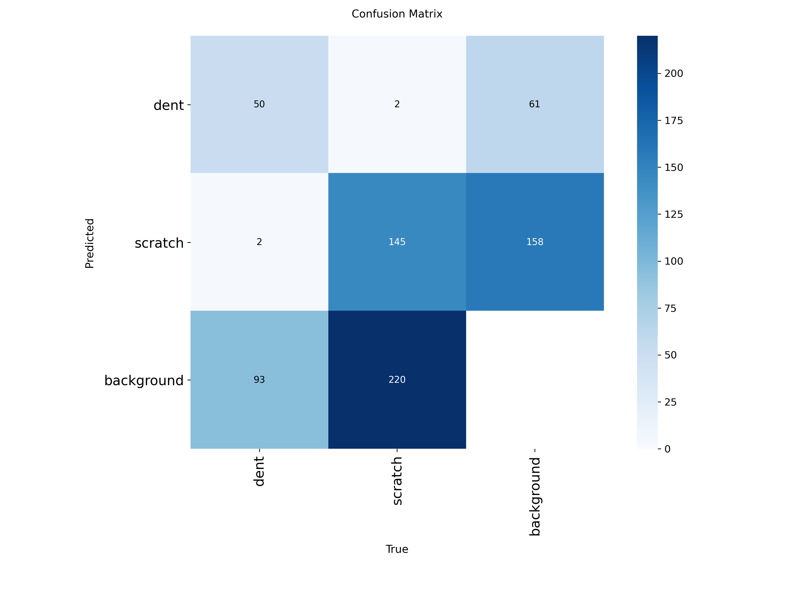
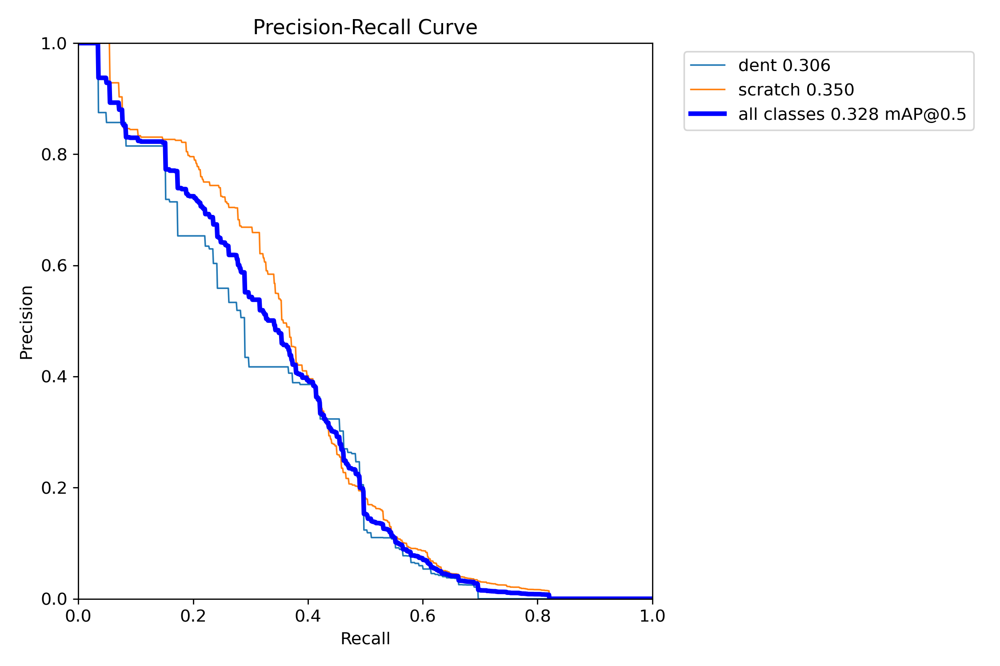
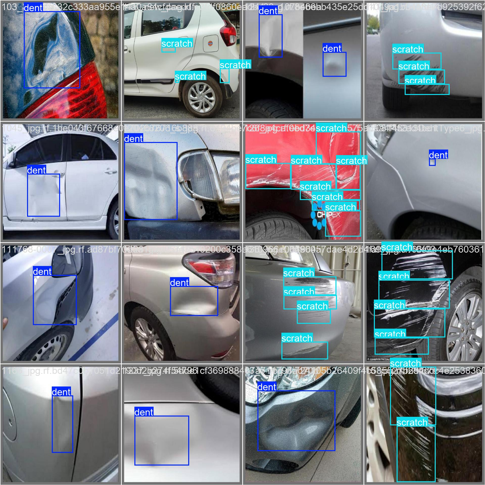
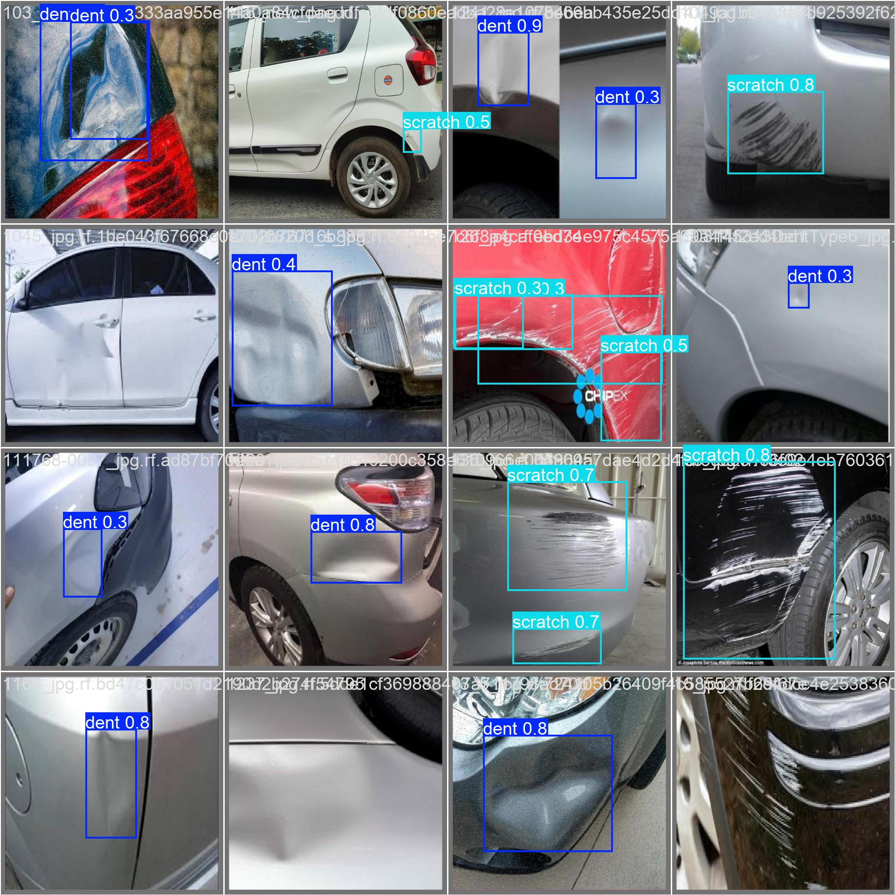

# 🚗 Detección de Daños en Vehículos

<div align="center">


**Sistema de visión por computadora para detección automática de abolladuras y rayaduras en automóviles**
basado en redes neuronales convolucionales YOLOv8, con interfaz gráfica local y API REST.

</div>

---

## 📋 Información académica

| Campo | Detalle |
|---|---|
| **Autor** | Andy Bardales |
| **Curso** | Ingeniería de Software |
| **Ciclo** | 7.° |
| **Año** | 2025 |
| **Repositorio** | [AndyBardales/vehicle-damage-detection](https://github.com/AndyBardales/vehicle-damage-detection) |

---

## 🎯 Descripción

Este proyecto implementa un sistema end-to-end de **detección de daños superficiales en vehículos** que cubre
todo el ciclo de vida de un modelo de deep learning:

1. **Entrenamiento** de un detector YOLOv8 personalizado sobre un dataset anotado de 1,259 imágenes.
2. **Prueba local** con visualización en tiempo real sobre fotos y videos mediante ventanas de OpenCV.
3. **Despliegue como servicio** mediante una API REST en Flask capaz de analizar imágenes y responder
   con las detecciones en formato JSON.

El modelo identifica **2 tipos de daño**:

| Clase | Daño | Descripción |
|---|---|---|
| 0 | `dent` | **Abolladuras** — deformaciones en la carrocería |
| 1 | `scratch` | **Rayaduras** — arañazos en la pintura |

Cada detección incluye el **tipo de daño**, su **posición** (centro del recorte en % respecto a la imagen)
y el **nivel de confianza** de la predicción.

---

## 🧠 Tecnologías utilizadas

| Tecnología | Versión | Rol en el proyecto |
|---|---|---|
| Python | 3.14 | Lenguaje de programación |
| Ultralytics | 8.4.64 | Framework de entrenamiento e inferencia YOLOv8 |
| PyTorch | 2.12.0 | Backend de deep learning |
| OpenCV | 4.13.0 | Visualización de imágenes y video anotados |
| Flask | 3.1.3 | API REST de despliegue |
| NumPy / Matplotlib | 2.4.6 / 3.10.9 | Procesamiento numérico y gráficos de entrenamiento |

---

## 📁 Estructura del proyecto

```
vehicle-damage-detection/
│
├── entrenar.py              # Entrena YOLOv8n con el dataset personalizado (50 épocas)
├── reanudar.py              # Reanuda un entrenamiento interrumpido desde last.pt
├── probar_foto.py           # Detección sobre una imagen con visualización OpenCV
├── probar_video.py          # Detección frame a frame sobre video o cámara web
├── servicio_api.py          # API REST con Flask (endpoint POST /detectar)
├── prueba.py                # Smoke test: verifica que OpenCV y YOLO estén instalados
│
├── modelo_danos.pt          # ⭐ Modelo entrenado (pesos finales, listo para inferencia)
├── yolov8n.pt               # Modelo base YOLOv8n preentrenado en COCO (para transfer learning)
├── requirements.txt         # Dependencias del proyecto
│
├── pruebas/                 # Imágenes de prueba para la inferencia
│   ├── auto.jpg / auto2.jpg / auto_prueba.jpg / xd.jpg
│   └── video_prueba.mp4
│
├── datasets/daños_auto/     # Dataset anotado en formato YOLO (no incluido en el repo*)
│   ├── data.yaml            # Configuración: clases, rutas y metadatos de Roboflow
│   ├── train/  (881 imágenes)
│   ├── valid/  (252 imágenes)
│   └── test/   (126 imágenes)
│
└── runs/detect/train/       # Resultados del entrenamiento (métricas y gráficos)
    ├── results.png
    ├── confusion_matrix.png
    ├── BoxPR_curve.png
    └── weights/ (best.pt, last.pt)
```

> \* El dataset (~49 MB) y el entorno virtual se excluyen del repositorio por tamaño. Ver
> [Dataset](#-dataset) para obtenerlo.

---

## 🗂️ Dataset

| Campo | Detalle |
|---|---|
| **Fuente** | [Roboflow Universe — scratch-dent-car-wo75v](https://universe.roboflow.com/mrs-workspace-s71yw/scratch-dent-car-wo75v/dataset/1) |
| **Imágenes** | 1,259 anotadas (881 train · 252 valid · 126 test) |
| **Formato** | YOLOv8 (bounding boxes en txt normalizados) |
| **Preprocesamiento** | Auto-orientación EXIF · Resize a 640×640 |
| **Licencia** | CC BY 4.0 |

Para re-entrenar, descarga el dataset desde Roboflow, colócalo en `datasets/daños_auto/` y ajusta las
rutas de `train`, `val` y `test` en `data.yaml`.

---

## ⚙️ Instalación

```bash
# 1. Clonar el repositorio
git clone https://github.com/AndyBardales/vehicle-damage-detection.git
cd vehicle-damage-detection

# 2. Crear y activar un entorno virtual (recomendado)
python -m venv env
env\Scripts\activate          # Windows
# source env/bin/activate     # Linux/macOS

# 3. Instalar dependencias
pip install -r requirements.txt

# 4. Verificar que todo funciona
python prueba.py
```

---

## 🚀 Uso

### 1 · Entrenar el modelo

```bash
python entrenar.py
```

> Usa transfer learning desde `yolov8n.pt` durante 50 épocas con `imgsz=640`.
> Si tienes GPU NVIDIA, deja `device='0'` en el script; si no, cámbialo por `device='cpu'`.

Si el entrenamiento se interrumpe, retómalo desde la última época guardada:

```bash
python reanudar.py
```

### 2 · Probar con una fotografía

```bash
python probar_foto.py
```

Abre una ventana de OpenCV con la imagen y los bounding boxes dibujados. Presiona cualquier tecla para cerrar.

### 3 · Probar con un video o la cámara web

```bash
python probar_video.py
```

Analiza el video `pruebas/video_prueba.mp4` frame a frame. Presiona **`q`** para salir.
(Cambia `video_path = 0` en el script para usar tu cámara web.)

### 4 · Lanzar la API REST

```bash
python servicio_api.py
```

El servidor queda escuchando en **`http://localhost:5000`**.

---

## 🔌 API REST

### `POST /detectar`

Recibe una imagen y devuelve las detecciones en JSON.

| Parámetro | Tipo | Detalle |
|---|---|---|
| `imagen` | archivo (multipart/form-data) | Formato `.jpg`, máximo **50 MB** |

**Ejemplo con curl:**

```bash
curl -X POST http://localhost:5000/detectar -F "imagen=@pruebas/xd.jpg"
```

**Respuesta exitosa (`200 OK`):**

```json
[
  { "tipo": "RAYADO",   "pos_x": 42.35, "pos_y": 61.08, "confianza": 0.87 },
  { "tipo": "ABOLLADO", "pos_x": 15.20, "pos_y": 30.50, "confianza": 0.62 }
]
```

| Campo | Significado |
|---|---|
| `tipo` | Clase detectada: `RAYADO` o `ABOLLADO` |
| `pos_x` / `pos_y` | Centro del bounding box en **porcentaje** respecto al ancho/alto de la imagen |
| `confianza` | Probabilidad de la predicción (0 a 1) |

**Errores posibles:**

| Código | Causa |
|---|---|
| `400` | Falta el campo `imagen`, formato no permitido, archivo vacío o mayor a 50 MB |
| `500` | Error durante la inferencia |

---

## 📊 Resultados del entrenamiento

Entrenamiento completo: **50 épocas** · `imgsz=640` · `batch=16` · modelo base `yolov8n` (nano)

| Métrica | Valor |
|---|---|
| Precision | 0.544 |
| Recall | 0.310 |
| **mAP@50** | **0.328** |
| mAP@50-95 | 0.171 |

### Curva de aprendizaje



### Matriz de confusión



### Curva Precision-Recall



### Etiquetas vs. predicciones

| Ground Truth | Predicciones |
|---|---|
|  |  |

> **Nota honesta:** siendo un YOLOv8 **nano** entrenado en CPU con un dataset relativamente pequeño,
> un mAP@50 ≈ 0.33 es un punto de partida válido, no un resultado de producción. Ver
> [Mejoras futuras](#-mejoras-futuras).

---

## 🛣️ Mejoras futuras

- [ ] Entrenar con `yolov8s` / `yolov8m` y con GPU para mejorar el mAP significativamente.
- [ ] Aumentar el dataset (más ángulos, iluminaciones y tipos de carrocería).
- [ ] Aplicar data augmentation agresivo y ajustar hiperparámetros (épocas, LR, batch).
- [ ] Agregar interfaz web (Streamlit/HTML) sobre la API existente.
- [ ] Soporte para más clases de daño (cristales rotos, faros, llantas).
- [ ] Despliegue con Docker y endpoint de health-check.

---

## 📌 Limitaciones conocidas

- El umbral de confianza en los scripts de inferencia es **0.15** (bajo, para no perder detecciones);
  en producción conviene subirlo (0.4–0.5).
- Solo se aceptan archivos `.jpg` en la API.
- Las rutas absolutas dentro de `datasets/daños_auto/data.yaml` apuntan a la ubicación original del
  proyecto; ajústalas a tu máquina antes de re-entrenar.

---

## ✍️ Autor

**Andy Bardales** — Ingeniería de Software · 7.° ciclo · 2025

---

## 📄 Licencia

Dataset bajo [CC BY 4.0](https://creativecommons.org/licenses/by/4.0/). Los pesos y el código del
proyecto se distribuyen con fines académicos.

Gracias a [Ultralytics](https://ultralytics.com/) y a [Roboflow Universe](https://universe.roboflow.com/)
por las herramientas y el dataset que hicieron posible este proyecto.
